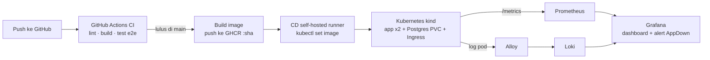

# Daily Task Tracker — Project Belajar DevOps

Aplikasi todo harian kecil (NestJS + Postgres) yang dibawa melewati **alur DevOps utuh**:
kode → test → image Docker → registry → Kubernetes → monitoring.
Aplikasinya sengaja sederhana; yang dipamerkan adalah alurnya.



## Daftar isi
- [Cara memakai aplikasi](#cara-memakai-aplikasi)
- [Tutorial step by step](#tutorial-step-by-step)
  - [0. Persiapan](#0-persiapan-sekali-saja)
  - [1. Jalankan & test aplikasi](#1-jalankan--test-aplikasi)
  - [2. Build image Docker](#2-build-image-docker)
  - [3. Docker Compose](#3-docker-compose)
  - [4. CI di GitHub Actions](#4-ci-di-github-actions)
  - [5. Deploy ke Kubernetes (kind)](#5-deploy-ke-kubernetes-kind)
  - [6. CD otomatis](#6-cd-otomatis-self-hosted-runner)
  - [7. Monitoring](#7-monitoring-prometheus-loki-grafana)
  - [8. Latihan skenario DevOps](#8-latihan-skenario-devops)
- [Mematikan & membersihkan](#mematikan--membersihkan)
- [Masalah umum](#masalah-umum)
- [Struktur folder](#struktur-folder) · [Dokumentasi per langkah](#dokumentasi-per-langkah)

---

## Cara memakai aplikasi

### Alamat aplikasi
| Cara menjalankan | Alamat |
|---|---|
| Lokal (`node dist/main.js`, langkah 1) | http://localhost:3000 |
| Docker Compose (langkah 3) | http://localhost:3001 |
| Kubernetes (langkah 5) | http://tasks.localhost |

### Lewat browser
Buka alamat di atas, lalu:
1. Ketik task di kolom **"Task hari ini..."**, klik **Tambah**.
2. Centang kotak di kiri task untuk menandai selesai (teks dicoret).
3. Klik **Hapus** untuk menghapus task.

Data tersimpan di Postgres, jadi tidak hilang saat halaman di-refresh atau container di-restart.

### Lewat API
| Method & path | Body | Hasil |
|---|---|---|
| `GET /tasks` | – | Daftar task (terbaru di atas) |
| `POST /tasks` | `{"title":"..."}` (1–200 karakter) | `201` task baru; `400` jika judul kosong/terlalu panjang |
| `PATCH /tasks/:id` | `{"done":true}` | Task yang diperbarui; `404` jika id tidak ada |
| `DELETE /tasks/:id` | – | `204`; `404` jika id tidak ada |
| `GET /health` | – | `{"status":"ok"}` jika app & database sehat, `503` jika DB putus |
| `GET /metrics` | – | Metrics format Prometheus (`http_requests_total`, dll.) |

Contoh (Git Bash), memakai versi Compose:
```bash
BASE=http://localhost:3001
curl $BASE/tasks
curl -X POST $BASE/tasks -H "Content-Type: application/json" -d '{"title":"Belajar Docker"}'
curl -X PATCH $BASE/tasks/1 -H "Content-Type: application/json" -d '{"done":true}'
curl -X DELETE $BASE/tasks/1
curl $BASE/health
```
Untuk versi Kubernetes, ganti dengan `curl -H "Host: tasks.localhost" http://localhost/tasks`
(curl di Windows tidak mengenal `tasks.localhost`, sedangkan browser Chrome/Edge mengenalnya).

### Tool monitoring (setelah langkah 7)
| Tool | Alamat | Login |
|---|---|---|
| Grafana | http://localhost:13000 | `admin` / `admin-belajar` |
| Prometheus | http://localhost:19090 | – |

---

## Tutorial step by step

> Semua perintah ditulis untuk **Git Bash** (ikut terpasang bersama Git for Windows) dan dijalankan dari **folder root repo**, kecuali disebut lain.
> Setiap langkah punya penjelasan konsep di `docs/steps/` (link di akhir langkah).

### 0. Persiapan (sekali saja)

Pasang tool (PowerShell / Terminal Windows):
```powershell
winget install Docker.DockerDesktop
winget install Git.Git
winget install OpenJS.NodeJS.LTS
winget install Kubernetes.kubectl
winget install Helm.Helm
winget install Kubernetes.kind
```
Lalu:
1. Buka **Docker Desktop** dan tunggu sampai statusnya *Engine running* (pakai backend WSL2).
2. Tutup dan buka lagi terminal agar PATH baru terbaca.
3. Cek semuanya terpasang:
   ```bash
   docker version && node -v && kubectl version --client && helm version && kind version
   ```
4. Clone repo ini dan masuk ke foldernya:
   ```bash
   git clone <url-repo-ini> belajar-devops
   cd belajar-devops
   ```

✅ **Berhasil jika:** semua perintah cek menampilkan versi tanpa error.

### 1. Jalankan & test aplikasi

```bash
# Postgres khusus test (port 5433 agar tidak bentrok dengan Postgres lain)
docker run -d --name dt-test-pg -e POSTGRES_PASSWORD=test -e POSTGRES_DB=tasks_test -p 5433:5432 postgres:16-alpine

cd app
npm install
npm run test:e2e          # menjalankan 10 test

npm run build
PORT=3000 DB_PORT=5433 DB_PASSWORD=test DB_NAME=tasks_test node dist/main.js
```
Buka http://localhost:3000, coba tambah/centang/hapus task. Tekan `Ctrl+C` untuk berhenti, lalu `cd ..` kembali ke root.

✅ **Berhasil jika:** output test `Tests  10 passed (10)` dan halaman bisa dipakai.
📖 Penjelasan: [01-aplikasi.md](docs/steps/01-aplikasi.md)

### 2. Build image Docker

```bash
docker build -t task-tracker:local app
docker image ls task-tracker:local
docker run --rm task-tracker:local id
```

✅ **Berhasil jika:** image muncul (±365 MB) dan `id` menampilkan `uid=1000(node)` (bukan root).
📖 Penjelasan: [02-docker.md](docs/steps/02-docker.md)

### 3. Docker Compose

```bash
cp compose/.env.example compose/.env      # lalu buka compose/.env dan ganti DB_PASSWORD
docker compose -f compose/docker-compose.yml --env-file compose/.env up -d --build
docker compose -f compose/docker-compose.yml --env-file compose/.env ps
curl http://localhost:3001/health
```
Buka http://localhost:3001.

Uji data permanen: tambah satu task, lalu
```bash
docker compose -f compose/docker-compose.yml --env-file compose/.env down
docker compose -f compose/docker-compose.yml --env-file compose/.env up -d
```
dan refresh halaman — task masih ada.

✅ **Berhasil jika:** `ps` menampilkan `db` dan `app` berstatus `healthy`, `/health` → `{"status":"ok"}`, data bertahan setelah `down`/`up`.
📖 Penjelasan: [03-docker-compose.md](docs/steps/03-docker-compose.md)

### 4. CI di GitHub Actions

1. Buat repo **kosong** di github.com (tanpa README/.gitignore).
2. Hubungkan dan push:
   ```bash
   git remote add origin https://github.com/<username>/<nama-repo>.git
   git push -u origin main
   ```
3. Buka tab **Actions** di repo → workflow **CI**: job `test` lalu `build-push` harus hijau.
4. Buka profil GitHub → **Packages** → `task-tracker` → **Package settings** → **Change visibility** → **Public**
   (agar Kubernetes bisa menarik image tanpa login).
5. Latihan: buat branch, ubah satu assertion di `app/test/tasks.e2e-spec.ts` hingga salah, push, buka Pull Request → job `test` merah dan `build-push` **tidak** berjalan. Hapus branch-nya setelah selesai.

✅ **Berhasil jika:** run CI hijau dan image `ghcr.io/<username>/task-tracker:<commit-sha>` ada di Packages.
📖 Penjelasan: [04-ci-github-actions.md](docs/steps/04-ci-github-actions.md)

### 5. Deploy ke Kubernetes (kind)

> Port **80** dan **443** di laptop harus kosong. Variabel `K` di bawah hanya berlaku di terminal yang sedang dibuka — ketik ulang jika membuka terminal baru.

```bash
# 5.1 Buat cluster dan siapkan shortcut kubectl (selalu menunjuk cluster ini)
kind create cluster --config k8s/kind-config.yaml
K="kubectl --context kind-task-tracker"

# 5.2 Masukkan image lokal ke cluster (dari langkah 2)
kind load docker-image task-tracker:local --name task-tracker

# 5.3 Pasang Ingress NGINX dan tunggu sampai siap (pertama kali bisa ±5 menit)
$K apply -f https://raw.githubusercontent.com/kubernetes/ingress-nginx/controller-v1.12.1/deploy/static/provider/kind/deploy.yaml
$K -n ingress-nginx wait --for=condition=ready pod -l app.kubernetes.io/component=controller --timeout=600s

# 5.4 Namespace + secret database (ganti <password-anda>)
$K apply -f k8s/00-namespace.yaml
$K -n task-tracker create secret generic db-secret \
  --from-literal=DB_USER=tasks --from-literal=DB_PASSWORD=<password-anda> --from-literal=DB_NAME=tasks

# 5.5 Postgres, app, dan ingress
$K apply -f k8s/10-postgres.yaml -f k8s/20-app.yaml -f k8s/30-ingress.yaml
$K -n task-tracker rollout status deploy/app --timeout=300s
$K -n task-tracker get pods

# 5.6 Cek
curl -H "Host: tasks.localhost" http://localhost/health
```
Buka http://tasks.localhost di browser.

Sudah menyelesaikan langkah 4? Pakai image dari GHCR alih-alih image lokal:
```bash
$K -n task-tracker set image deployment/app app=ghcr.io/<username>/task-tracker:latest
```

✅ **Berhasil jika:** 2 pod `app-...` dan `postgres-0` berstatus `Running` dengan `READY 1/1`, dan `/health` → `{"status":"ok"}`.
(Pod app restart 1–2× di awal itu wajar — ia menunggu Postgres siap.)
📖 Penjelasan: [05-kubernetes.md](docs/steps/05-kubernetes.md)

### 6. CD otomatis (self-hosted runner)

Butuh langkah 4 dan 5 selesai.

1. **Pasang runner** di laptop yang menjalankan cluster: repo GitHub → **Settings → Actions → Runners → New self-hosted runner** → pilih **Windows**, lalu ikuti perintah yang ditampilkan (unduh, `config.cmd`, `run.cmd`) di folder di luar repo, misalnya `C:\actions-runner`.
2. Di terminal tempat runner berjalan, pastikan `kubectl --context kind-task-tracker get nodes` berhasil di PowerShell (workflow CD memakai `shell: powershell`).
3. **Amankan runner** (penting untuk repo publik): **Settings → Actions → General → Fork pull request workflows** → wajibkan approval untuk kontributor luar.
4. **Coba deploy otomatis:** ubah judul `<h1>` di `app/public/index.html`, lalu
   ```bash
   git commit -am "ubah judul" && git push
   ```
   Di tab **Actions**: **CI** berjalan dulu, setelah hijau **CD** berjalan di runner Anda.
5. Cek image yang sedang berjalan:
   ```bash
   $K -n task-tracker get deploy app -o jsonpath='{.spec.template.spec.containers[0].image}'
   ```

✅ **Berhasil jika:** CD hijau, image = `ghcr.io/<username>/task-tracker:<sha-commit-terakhir>`, dan http://tasks.localhost menampilkan judul baru.
⚠️ Setelah CD aktif, jangan `kubectl apply -f k8s/20-app.yaml` lagi — image akan kembali ke `task-tracker:local`.
📖 Penjelasan: [06-cd.md](docs/steps/06-cd.md)

### 7. Monitoring (Prometheus, Loki, Grafana)

```bash
H="helm --kube-context kind-task-tracker"
M="kubectl --context kind-task-tracker -n monitoring"

# 7.1 Repo chart
helm repo add prometheus-community https://prometheus-community.github.io/helm-charts
helm repo add grafana https://grafana.github.io/helm-charts
helm repo update

# 7.2 Pasang stack (pertama kali ±10 menit karena image besar)
$H upgrade --install monitoring prometheus-community/kube-prometheus-stack -n monitoring --create-namespace -f monitoring/prometheus-values.yaml --wait --timeout 15m
$H upgrade --install loki  grafana/loki  -n monitoring -f monitoring/loki-values.yaml  --wait --timeout 10m
$H upgrade --install alloy grafana/alloy -n monitoring -f monitoring/alloy-values.yaml --wait --timeout 10m

# 7.3 Scrape app, alert, dan dashboard
$M apply -f monitoring/servicemonitor.yaml -f monitoring/alert-rules.yaml
$M create configmap task-tracker-dashboard --from-file=task-tracker.json=monitoring/dashboards/task-tracker.json --dry-run=client -o yaml \
  | $M label --local -f - grafana_dashboard=1 -o yaml | $M apply -f -
```

Buka akses ke Grafana dan Prometheus — **masing-masing di terminal terpisah** (perintahnya terus berjalan; `Ctrl+C` untuk berhenti):
```bash
kubectl --context kind-task-tracker -n monitoring port-forward svc/monitoring-grafana 13000:80
kubectl --context kind-task-tracker -n monitoring port-forward svc/monitoring-kube-prometheus-prometheus 19090:9090
```

Buat sedikit trafik agar grafik bergerak:
```bash
for i in $(seq 1 100); do curl -s -o /dev/null -H "Host: tasks.localhost" http://localhost/tasks; done
```

Lalu lihat:
1. **Grafana** http://localhost:13000 (login `admin` / `admin-belajar`) → **Dashboards → Task Tracker**: pod up, request/detik, error 5xx, memori, log.
2. **Log**: Grafana → **Explore** → pilih **Loki** → query `{namespace="task-tracker", app="app"}`.
3. **Prometheus** http://localhost:19090 → **Status → Targets**: target `task-tracker-app` berstatus **UP** (2 endpoint). Menu **Alerts** menampilkan `AppDown`.

✅ **Berhasil jika:** panel "Pod app yang up" = 2, grafik request bergerak, dan log app muncul.
📖 Penjelasan: [07-observability.md](docs/steps/07-observability.md)

### 8. Latihan skenario DevOps

Pakai `K="kubectl --context kind-task-tracker"`.

**A. Pod mati → Kubernetes memperbaiki sendiri**
```bash
$K -n task-tracker get pods
$K -n task-tracker delete pod <nama-salah-satu-pod-app>
$K -n task-tracker get pods -w        # pod baru dibuat otomatis; Ctrl+C untuk berhenti
```
Selama itu http://tasks.localhost tetap bisa dibuka karena masih ada pod kedua.

**B. Deploy gagal → rollback**
```bash
$K -n task-tracker set image deployment/app app=task-tracker:tag-yang-tidak-ada
$K -n task-tracker rollout status deployment/app --timeout=60s   # gagal (timeout)
$K -n task-tracker get pods                                       # pod baru ImagePullBackOff, pod lama tetap jalan
$K -n task-tracker rollout undo deployment/app                    # kembali ke versi sebelumnya
```

**C. App mati total → alert menyala**
```bash
$K -n task-tracker scale deploy/app --replicas=0
# tunggu ±2 menit, lalu buka http://localhost:19090/alerts → AppDown: pending → firing
$K -n task-tracker scale deploy/app --replicas=2
```

---

## Mematikan & membersihkan

| Yang ingin dimatikan | Perintah |
|---|---|
| App lokal (langkah 1) | `Ctrl+C` |
| Compose (data tetap) | `docker compose -f compose/docker-compose.yml --env-file compose/.env down` |
| Compose + hapus data | tambahkan `-v` pada perintah di atas |
| Port-forward Grafana/Prometheus | `Ctrl+C` di terminalnya |
| Seluruh Kubernetes + monitoring (data ikut hilang) | `kind delete cluster --name task-tracker` |
| Postgres untuk test | `docker rm -f dt-test-pg` |
| Runner GitHub | `Ctrl+C` di terminal `run.cmd` |

Cluster kind memakai ±2,5–3 GB RAM saat monitoring terpasang; hapus cluster jika laptop terasa berat.

## Masalah umum

| Gejala | Penyebab | Solusi |
|---|---|---|
| `failed to connect to the docker API ... dockerDesktopLinuxEngine` | Docker Desktop belum berjalan | Buka Docker Desktop, tunggu *Engine running* |
| `port is already allocated` / `bind: Only one usage of each socket address` | Port sudah dipakai program lain | Compose: ubah `APP_PORT` di `compose/.env`. Lokal: ganti `PORT=` |
| Test e2e gagal `ECONNREFUSED ...:5433` | Container Postgres test mati | `docker start dt-test-pg` |
| `kind create cluster` gagal di port 80/443 | Port dipakai program lain (IIS, XAMPP, dll.) | Matikan program itu, atau ubah `hostPort` di `k8s/kind-config.yaml` |
| `failed calling webhook "validate.nginx.ingress.kubernetes.io"` | Controller Ingress belum siap | Jalankan perintah `wait` di 5.3, lalu ulangi `apply` |
| Pod app `ImagePullBackOff` | Image belum dimuat ke kind, atau paket GHCR masih private | `kind load docker-image task-tracker:local --name task-tracker`, atau jadikan paket GHCR **Public** |
| `kubectl` error `connection refused 127.0.0.1:<port>` setelah laptop restart | Docker Desktop / node kind belum hidup | Buka Docker Desktop; bila perlu `docker start task-tracker-control-plane` |
| Perintah `kubectl` mengenai cluster lain | Context default menunjuk cluster lain | Selalu pakai `--context kind-task-tracker`; cek dengan `kubectl config get-contexts` |
| `helm ... --wait` timeout saat pertama install | Image besar masih diunduh | Jalankan ulang perintah `helm upgrade --install` yang sama |
| Panel log di dashboard: *Data source not found* | Datasource Loki di Grafana dibuat sebelum `uid: loki` ditetapkan | `kubectl --context kind-task-tracker -n monitoring delete pod -l app.kubernetes.io/name=grafana` |
| http://localhost:13000 tidak bisa dibuka | Port-forward berhenti (terminal ditutup / pod Grafana diganti) | Jalankan ulang perintah `port-forward` |

---

## Struktur folder
```
app/                 backend NestJS, frontend statis (public/), Dockerfile, test e2e
compose/             docker-compose.yml + .env.example
k8s/                 manifest Kubernetes + kind-config
monitoring/          values Helm, ServiceMonitor, alert, dashboard JSON
.github/workflows/   ci.yml, cd.yml
docs/steps/          dokumentasi per langkah (bernomor)
docs/superpowers/    desain & rencana project
handoffs/            catatan pekerjaan yang masih tertunda
```

## Dokumentasi per langkah
1. [Aplikasi NestJS + Postgres](docs/steps/01-aplikasi.md)
2. [Docker](docs/steps/02-docker.md)
3. [Docker Compose](docs/steps/03-docker-compose.md)
4. [CI dengan GitHub Actions](docs/steps/04-ci-github-actions.md)
5. [Kubernetes (kind)](docs/steps/05-kubernetes.md)
6. [CD + rollback](docs/steps/06-cd.md)
7. [Observability: Prometheus, Loki, Grafana](docs/steps/07-observability.md)
8. [Penutup & cara mengulang](docs/steps/08-readme-akhir.md)

## Yang saya pelajari
- Image yang sama berjalan di laptop, CI, dan Kubernetes karena konfigurasi masuk lewat environment variable.
- Healthcheck/readiness menentukan kapan trafik boleh masuk; tanpa itu deploy bisa menyebabkan downtime.
- Deploy yang gagal tidak merusak versi berjalan (rolling update), dan rollback cukup satu perintah.
- Metrics untuk tahu *ada* masalah, logs untuk tahu *kenapa*.

## Pengembangan lanjutan
Terraform + cloud (EKS/GKE), GitOps dengan Argo CD, Alertmanager → notifikasi Slack/email, migrasi database (ganti `synchronize: true`), scan keamanan image (Trivy) di CI.
