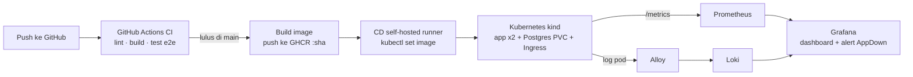

# Daily Task Tracker — Project Belajar DevOps

Aplikasi todo harian kecil (NestJS + Postgres) yang dibawa melewati **alur DevOps utuh**:
kode → test → image Docker → registry → Kubernetes → monitoring.
Aplikasinya sengaja sederhana; yang dipamerkan adalah alurnya.



## Alur pengerjaan (baca berurutan)
1. [Aplikasi NestJS + Postgres](docs/steps/01-aplikasi.md)
2. [Docker](docs/steps/02-docker.md)
3. [Docker Compose](docs/steps/03-docker-compose.md)
4. [CI dengan GitHub Actions](docs/steps/04-ci-github-actions.md)
5. [Kubernetes (kind)](docs/steps/05-kubernetes.md)
6. [CD + rollback](docs/steps/06-cd.md)
7. [Observability: Prometheus, Loki, Grafana](docs/steps/07-observability.md)
8. [Penutup & cara mengulang](docs/steps/08-readme-akhir.md)

## Struktur folder
```
app/                 backend NestJS, frontend statis (public/), Dockerfile, test e2e
compose/             docker-compose.yml + .env.example
k8s/                 manifest Kubernetes + kind-config
monitoring/          values Helm, ServiceMonitor, alert, dashboard JSON
.github/workflows/   ci.yml, cd.yml
docs/steps/          dokumentasi per langkah (bernomor)
docs/superpowers/    desain & rencana project
```

## Prasyarat (Windows 11)
Docker Desktop (WSL2), Node.js 22+, Git, kubectl, Helm, kind (`winget install Kubernetes.kind`).

## Cepat mencoba
```bash
cp compose/.env.example compose/.env
docker compose -f compose/docker-compose.yml --env-file compose/.env up -d --build
# buka http://localhost:3001
```
Versi Kubernetes + monitoring: ikuti langkah 05 → 07.

## Yang saya pelajari
- Image yang sama berjalan di laptop, CI, dan Kubernetes karena konfigurasi masuk lewat environment variable.
- Healthcheck/readiness menentukan kapan trafik boleh masuk; tanpa itu deploy bisa menyebabkan downtime.
- Deploy yang gagal tidak merusak versi berjalan (rolling update), dan rollback cukup satu perintah.
- Metrics untuk tahu *ada* masalah, logs untuk tahu *kenapa*.

## Pengembangan lanjutan
Terraform + cloud (EKS/GKE), GitOps dengan Argo CD, Alertmanager → notifikasi Slack/email, migrasi database (ganti `synchronize: true`), scan keamanan image (Trivy) di CI.
